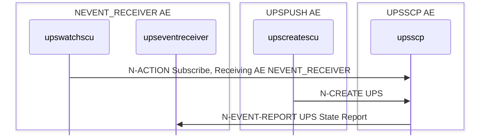

# Securing connections with TLS

The CLI applications can secure their connections with TLS or mutual TLS.

## Applications

The following CLI applications support TLS:

- SCPs: `echoscp`, `storescp` and `upseventreceiver`
- SCUs: `storescu`, `upsfind`, `upscreatescu`, `upschangestatescu`, `upswatchscu` and `upsmodifyscu`
- SCP and SCU: `upsscp`

> **Note:** This document deviates from the DICOM terminology: SCP is used for an application that accepts
> associations (a TLS server) and SCU for one that requests them (a TLS client), as the TLS options depend on these
> roles. In DICOM, the SCP and SCU roles are defined for each SOP class and can be reversed. In the UPS Event SOP
> Class (DICOM PS3.4 CC.2.4), `upseventreceiver` is the SCU and `upsscp` the SCP.

TLS is off by default.

## Quick start

First prepare the certificate, key and CA files of these examples for testing, as explained in
[Certificates](#certificates).

From the top level directory of the project, set up the Python environment with Poetry:

```shell
poetry install
```

Then start an application with TLS:

```shell
python tdwii_plus_examples/cli/echoscp.py --port 2762 \
  --tls --tls-cert scp.pem --tls-key scp.key
```

Or with mutual TLS:

```shell
python tdwii_plus_examples/cli/storescp.py --port 2762 \
  --mtls --tls-cert scp.pem --tls-key scp.key --tls-ca rootCA.pem
```

With `--verbose`, the application logs the TLS session of each connection, including the subject
of the client certificate when there is one.

## Specifying TLS options

### Options and their meaning

One of `--tls` or `--mtls` is needed to enable TLS:

| Option | Meaning |
|---|---|
| `--tls` | Use TLS |
| `--mtls` | Use mutual TLS: the remote AEs must also authenticate themselves |
| `--tls-cert FILE` | PEM certificate of the application |
| `--tls-key FILE` | PEM private key of the application |
| `--tls-ca FILE` | PEM certificate authorities trusted to verify the remote AEs |

### Options required by role

The files needed depend on the role of the application:

| Role | `--tls` | `--mtls` |
|---|---|---|
| SCP (server) | `--tls-cert` and `--tls-key` | `--tls-cert`, `--tls-key` and `--tls-ca` |
| SCU (client) | `--tls-ca` | `--tls-ca`, `--tls-cert` and `--tls-key` |
| SCP and SCU (both) | `--tls-cert`, `--tls-key` and `--tls-ca` | `--tls-cert`, `--tls-key` and `--tls-ca` |

`upsscp` is both, as it accepts the associations of the UPS SCUs and requests associations to send the UPS event
reports to the subscribers. It presents the same certificate in both roles, also with `--tls` when a subscriber asks
for a client certificate.

An application never uses the certificate authorities of the system (Windows Certificate Manager,
macOS Keychain Access, Linux `/etc/ssl/certs`), it only trusts the ones given with `--tls-ca`.

### Options validated at startup

The application validates the TLS options at startup, so that inconsistent options never leave the connections
unsecured. It stops with an error naming the inconsistent option when:

- `--tls` and `--mtls` are both present
- a `--tls-*` option is present without `--tls` or `--mtls`
- a file required by its role is not given, or does not exist
- `--tls-ca` is present without `--mtls`, for an SCP
- `--tls-cert` and `--tls-key` are present without `--mtls`, for an SCU

### Options in the upsscp configuration file

`upsscp` also reads the TLS settings from its configuration file,
`tdwii_plus_examples/cli/upsscp/config/upsscp_default.ini` by default.

```ini
tls: mtls
tls_cert: certs/upsscp.pem
tls_key: certs/upsscp.key
tls_ca: certs/rootCA.pem
```

Each option has a matching setting:
| Setting | Option | Value |
|---|---|---|
| `tls` | `--tls` or `--mtls` | `off` (default), `tls` or `mtls` |
| `tls_cert` | `--tls-cert` | Path of the PEM file with the certificate of the application |
| `tls_key` | `--tls-key` | Path of the PEM file with the private key of the application |
| `tls_ca` | `--tls-ca` | Path of the PEM file with the certificate authorities trusted to verify the remote AEs |

An option on the command line takes precedence over its setting, and the other settings still apply.
File paths of settings are relative to the `tdwii_plus_examples/cli/upsscp` directory, whereas file paths of options
are relative to the current directory.

## Authentication of the remote AE

A remote AE authenticates itself with its certificate, and proves during the TLS handshake that it holds the private
key of that certificate. An SCP (a TLS server) asks the remote AE to authenticate only with `--mtls`. An SCU
(a TLS client) always authenticates the remote AE, with `--tls` or `--mtls`.

The certificate of the remote AE is verified as follows:

- Its certification path is validated up to a CA of the `--tls-ca` file, including the signatures and the validity
  periods.
- An SCU checks that it is issued for the host it calls: the hostname or IP address it connects to must be in the
  `subjectAltName` of the certificate. An SCP does not check the host of the remote AE.
- Nothing binds it to an AE title.
- Its revocation is not checked.

An SCU therefore knows that the SCP holds a certificate issued by a trusted CA for the host it called. An SCP with
`--mtls` knows only that the SCU holds a certificate issued by a trusted CA. Neither knows that the remote AE is the AE
that was called or expected.

The applications do not claim conformance to the TLS Secure Transport Connection Profiles of DICOM PS3.15.

## Certificates

TLS needs a **public key infrastructure (PKI)** to create, manage and use digital certificates.
The certificates and keys are not part of this repository: create your own, and keep the private keys private.
A root certificate authority (CA) is not provided either. A CA is an entity that signs certificates: an application
that trusts a CA trusts the certificates it signed. A root CA is at the top of that chain of trust, and its own
certificate is self-signed. It can delegate the signing to intermediate CAs, whose certificates it signed.

The `--tls-ca` file holds the root CAs that an application trusts to verify the remote AEs, concatenated if there are
several (it can also hold individual certificates to trust).
When the certificate of an application was signed by an intermediate CA, the `--tls-cert` file must hold that
certificate followed by the certificates of the intermediate CAs, so that the remote AEs can verify the whole chain
up to a root CA they trust.

The following creates, with [OpenSSL](https://www.openssl.org/), a root certificate authority, a certificate for a
SCP (valid for `localhost` and `127.0.0.1`) and a certificate for an SCU, for testing.
The authority key used here is not encrypted: do not use this setup in production,
where the certificates are normally issued by the PKI of the institution.

Save the configuration of the root certificate authority as `rootCA.cnf`:

```ini
[ req ]
distinguished_name = req_distinguished_name
x509_extensions    = v3_ca
prompt             = no

[ req_distinguished_name ]
O  = Springfield General Hospital
OU = IT Department
CN = Springfield General Hospital Root CA

[ v3_ca ]
subjectKeyIdentifier   = hash
authorityKeyIdentifier = keyid:always,issuer
basicConstraints       = critical, CA:true
keyUsage               = critical, digitalSignature, cRLSign, keyCertSign
```

The configuration of an application is the same for the SCP and the SCU, with its own name.
Save this one as `scp.cnf` and, for the SCU, as `scu.cnf` with `CN = RO SCU`.
The `subjectAltName` lists the hostnames and IP addresses of the AE, which remote AEs can check to verify its
identity. The `CN` is only a label, logged for instance with `--verbose`.

```ini
[ req ]
distinguished_name = req_distinguished_name
prompt             = no

[ req_distinguished_name ]
O  = Springfield General Hospital
OU = Radiation Oncology
CN = RO SCP

[ v3_req ]
subjectKeyIdentifier   = hash
authorityKeyIdentifier = keyid,issuer
basicConstraints       = CA:FALSE
keyUsage               = critical, digitalSignature, keyEncipherment
extendedKeyUsage       = serverAuth, clientAuth
subjectAltName         = @alt_names

[ alt_names ]
DNS.1 = localhost
IP.1  = 127.0.0.1
```

Then create the root certificate authority, and the certificates signed by it:

```shell
# Root certificate authority
openssl genrsa -out rootCA.key 2048
openssl req -new -x509 -key rootCA.key -days 365 -config rootCA.cnf -out rootCA.pem

# SCP and SCU certificates
for name in scp scu; do
  openssl genrsa -out $name.key 2048
  openssl req -new -key $name.key -config $name.cnf -out $name.csr
  openssl x509 -req -in $name.csr -CA rootCA.pem -CAkey rootCA.key -CAcreateserial -days 365 \
    -extfile $name.cnf -extensions v3_req -out $name.pem
done
```

This produces `rootCA.pem` (to be trusted by the remote AEs), `scp.pem` and `scp.key` for the SCP,
and `scu.pem` and `scu.key` for the SCU.

## Testing the SCP applications

The examples connect to `echoscp`, started on port 2762 with the AE title `ECHOSCP`:

```shell
python tdwii_plus_examples/cli/echoscp.py -a ECHOSCP --port 2762 \
  --mtls --tls-cert scp.pem --tls-key scp.key --tls-ca rootCA.pem --verbose
```

### With OpenSSL

`openssl s_client` checks that the application started above accepts TLS connections
and that its certificate is trusted.
Add `-cert scu.pem -key scu.key` when the application was started with `--mtls`.
With TLS 1.3, `s_client` considers the handshake complete before the server checks the client certificate, so a refusal
only shows afterwards, as the alert `certificate required`.

```shell
openssl s_client -connect localhost:2762 -servername localhost -CAfile rootCA.pem -verify_return_error
```

### With DCMTK

Download and install the [DCMTK tools](https://dcmtk.org/en/dcmtk/dcmtk-tools/).
With Windows, download also the OpenSSL based security extensions, which provide the `-tls` variant of the tools
(`echoscu-tls`) used below. On Linux and macOS, use `echoscu` (DCMTK built with OpenSSL).

Verification with a client certificate, with Windows:

```shell
echoscu-tls -v +tls scu.key scu.pem +cf rootCA.pem -aec ECHOSCP localhost 2762
```

With `--mtls`, a client without certificate (anonymous TLS) is refused:

```shell
echoscu-tls -v +tla +cf rootCA.pem -aec ECHOSCP localhost 2762
```

### With dcm4che

Download and install the [dcm4che utilities](https://github.com/dcm4che/dcm4che/releases).
With Windows, use the `.bat` launchers (`storescu.bat`).

dcm4che is a Java application that does not read the PEM files created above.
The next two steps create PKCS#12 files from the PEM files.

#### 1. Create the keystore

A **keystore** holds keys, each with its certificate, here the key and the certificate of the SCU.
Create it from `scu.pem` and `scu.key` with `openssl`:

```shell
openssl pkcs12 -export -in scu.pem -inkey scu.key -out scu.p12 -passout pass:secret
```

#### 2. Create the truststore

A **truststore** holds the certificates of the trusted authorities, here the root CA.
The tool to create it from `rootCA.pem` depends on the version of OpenSSL:

```shell
openssl version
```

With OpenSSL 3.2 or later, use `openssl`:

```shell
openssl pkcs12 -export -nokeys -jdktrust anyExtendedKeyUsage -in rootCA.pem -out rootCA.p12 -passout pass:secret
```

With an older version, use `keytool`, a tool of the Java JDK.
It will ask you to confirm that the certificate is trusted: answer `yes`.

```shell
keytool -importcert -keystore rootCA.p12 -storetype PKCS12 -storepass secret -file rootCA.pem -alias rootca
```

If you run `keytool` again, for instance with a new root CA, delete `rootCA.p12` first, or `keytool` will fail
because that file already has a `rootca` entry.

#### 3. Verify the connection

With no file to send, `storescu` does a verification (C-ECHO). Run it against the application started above with
`--mtls`:

```shell
storescu -c ECHOSCP@localhost:2762 \
  --tls-cipher TLS_ECDHE_RSA_WITH_AES_128_GCM_SHA256 \
  --key-store scu.p12 --key-store-pass secret \
  --trust-store rootCA.p12 --trust-store-pass secret
```

About the dcm4che options:

- Giving the keystore and the truststore is not enough to secure the connection: TLS is enabled by one of the options
  `--tls`, `--tls-null`, `--tls-aes`, `--tls-3des` or `--tls-cipher`, which differ by the cipher suites they enable.
  Without one of them, the connection is not secured and the application closes it.
- Use `--tls-cipher`: according to the dcm4che help, the other options enable only suites that these applications
  refuse (no encryption, RSA key exchange, 3DES).
- dcm4che enables only TLS 1.2 by default, and options such as `--tls13` do not enable TLS by themselves.
  To use TLS 1.3, add `--tls13` and a TLS 1.3 suite: `--tls13 --tls-cipher TLS_AES_256_GCM_SHA384`.

Without `--key-store`, dcm4che uses its own default key store (`resource:key.p12`), and an application started with
`--mtls` refuses the connection.
To get the details of the TLS handshake in case of errors, run `export JAVA_OPTS="-Djavax.net.debug=all"` first.

## Testing the SCU applications

The examples connect to `echoscp`, started on port 2762 with the AE title `ECHOSCP`:

```shell
python tdwii_plus_examples/cli/echoscp.py -a ECHOSCP --port 2762 \
  --mtls --tls-cert scp.pem --tls-key scp.key --tls-ca rootCA.pem --verbose
```

Check that `storescu` connects with mutual TLS. With `--echo`, it does a verification (C-ECHO) and sends no file:

```shell
python tdwii_plus_examples/cli/storescu.py --echo -aec ECHOSCP --mtls --tls-ca rootCA.pem \
  --tls-cert scu.pem --tls-key scu.key localhost 2762
```

An SCU application always needs `--tls-ca`, to verify the certificate of the SCP.

## Testing the UPS Service application

### upsscp works with mutual TLS in its two roles

`upsscp` acts as a TLS server when it accepts the associations of the UPS SCUs, and as a TLS client, with the same
certificate, when it sends the UPS event reports:



Run each application in its own terminal, from the top level directory, with the certificates created above.

1. Create a UPS instance file:

   ```shell
   python -c "from tdwii_plus_examples.tests.utils.generate_sop_instances import generate_ups_file; \
     generate_ups_file('.', 'ups.dcm')"
   ```

2. Start `upseventreceiver` as `NEVENT_RECEIVER` on port 11115, the address of this AE in
   `tdwii_plus_examples/config/ApplicationEntities.json`:

   ```shell
   python tdwii_plus_examples/cli/upseventreceiver.py -a NEVENT_RECEIVER -p 11115 -v \
     --mtls --tls-cert scp.pem --tls-key scp.key --tls-ca rootCA.pem
   ```

3. Start `upsscp` on port 11114, as configured in its default configuration file:

   ```shell
   python tdwii_plus_examples/cli/upsscp/upsscp.py -v \
     --mtls --tls-cert scp.pem --tls-key scp.key --tls-ca rootCA.pem
   ```

4. Subscribe `NEVENT_RECEIVER` globally. `upswatchscu` subscribes the AE of its own AE title, so with
   `-aet NEVENT_RECEIVER` it acts as the same AE as `upseventreceiver`. It prints `Global Subscription successful`:

   ```shell
   python tdwii_plus_examples/cli/upswatchscu.py -aet NEVENT_RECEIVER -aec UPSSCP \
     --mtls --tls-cert scu.pem --tls-key scu.key --tls-ca rootCA.pem localhost 11114
   ```

5. Create the UPS. `upscreatescu` prints `UPS creation successful`, and `upseventreceiver` logs the TLS session with
   the client certificate of `upsscp` (`RO SCP`), then the UPS State Report:

   ```shell
   python tdwii_plus_examples/cli/upscreatescu.py -aet UPSPUSH -aec UPSSCP \
     --mtls --tls-cert scu.pem --tls-key scu.key --tls-ca rootCA.pem localhost 11114 ups.dcm
   ```

### upsscp refuses an SCU without a client certificate

With `upsscp` started as in the previous test, `upswatchscu` prints
`Global Subscription failed: Association could not be established`:

```shell
python tdwii_plus_examples/cli/upswatchscu.py -aet NEVENT_RECEIVER -aec UPSSCP \
  --tls --tls-ca rootCA.pem localhost 11114
```

## Testing across hosts

The [TLS lab](tls-lab.md) runs the CLI applications and the dcm4che tools on two Docker hosts, each with a certificate
issued for its own host name and IP address.
